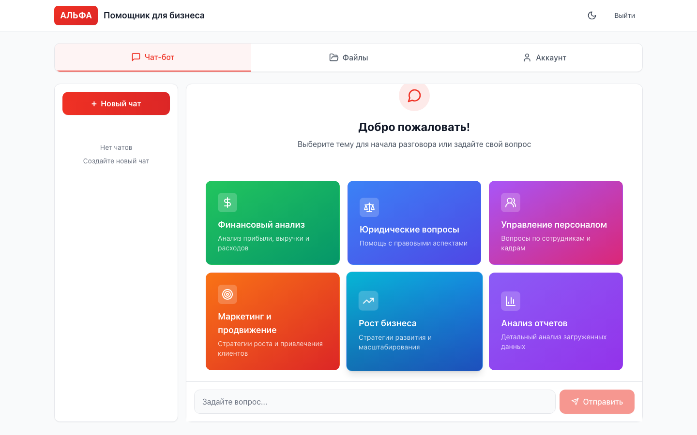
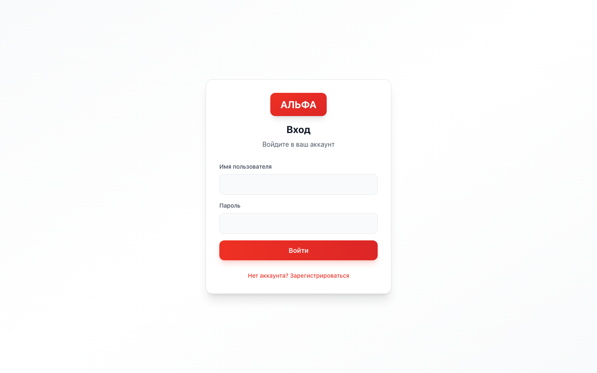

# Помощник для малого бизнеса

Командный проект для хакатона Альфа-Банка. Владелец бизнеса указывает профиль компании, загружает документы и задаёт вопросы о финансах, найме или маркетинге. Интерфейс работает на Next.js и React, сервер на Go сохраняет данные в SQLite и отправляет запросы модели через OpenRouter.



*Рабочее пространство с темами для нового разговора*



*Вход в учётную запись владельца бизнеса*

## Запуск

Скопируйте шаблон и укажите собственный ключ в переменной `OPENROUTER_API_KEY` для ответов модели.

```bash
cp backend/.env.example backend/.env
# Заполните backend/.env
docker compose up --build
```

Откройте [localhost:3000](http://localhost:3000). После регистрации можно заполнить профиль, открыть чат и загрузить файл.

## Что проверено

Проверены сборка клиента, запуск Go-сервера, регистрация, вход и открытие чата с тестовой учётной записью. Запрос к платному или внешнему AI не выполнялся. Полный запуск стека в Docker при проверке прервался из-за нехватки места в диске Docker Desktop.

## Авторство

Проект команды VIPERRRRS. [Исходный репозиторий](https://github.com/rumyaw/alfa_hack_VIPERRRRS)
